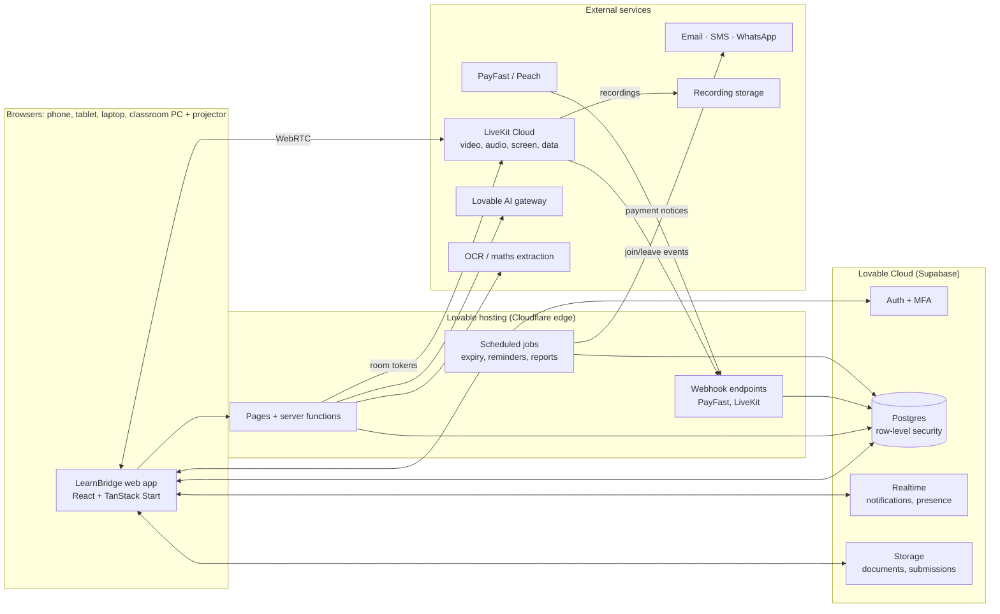
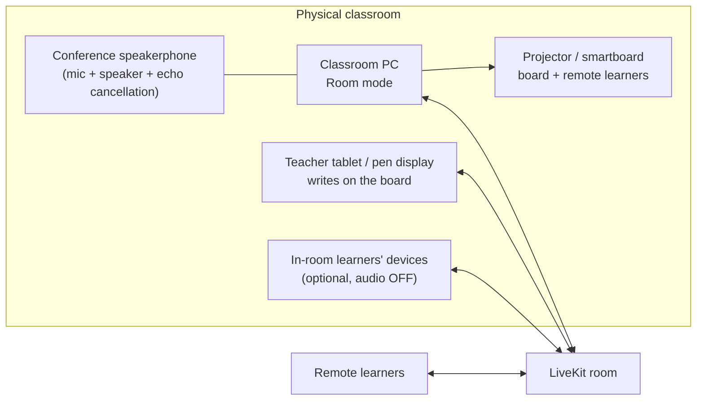
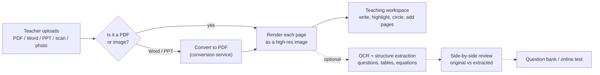

# 1. System architecture

## The big picture



**In plain language.** Each user's browser talks to the database directly for everyday reading and saving, such as listing classes or saving a homework answer. That is safe because the database checks every request against the person's role and school. Anything that involves money, secrets, someone else's account, or an outside provider goes through a server function instead. Server functions hold the keys that must never reach a browser.

## Building blocks

| Block             | Responsibility                                                                           | Talks to                                |
| ----------------- | ---------------------------------------------------------------------------------------- | --------------------------------------- |
| **Identity**      | Sign-in, password reset, MFA for admins, sessions, role switching                        | Supabase Auth                           |
| **Tenancy**       | Institutions (schools, tutoring centres, independent teachers), memberships, invitations | Postgres                                |
| **People**        | Learners, guardians, guardian-learner links, consent, suspensions, enrolment history     | Postgres                                |
| **Academics**     | Grades, subjects, classes, teaching assignments, academic years and terms                | Postgres                                |
| **Scheduling**    | Timetable, lessons, recurring lessons, rooms, conflict prevention                        | Postgres                                |
| **Classroom**     | Live lessons, hybrid room mode, participant controls, attendance, recording              | LiveKit, Postgres, R2                   |
| **Whiteboard**    | Pages, strokes, shapes, maths, images; live sync; saved boards                           | LiveKit data channel, Postgres, Storage |
| **Content**       | Resources library, document import, page rendering, annotations                          | Storage, OCR, conversion service        |
| **Work**          | Homework, submissions, question bank, tests and exams, marking, moderation               | Postgres, Storage                       |
| **Billing**       | Plans, per-learner subscriptions, invoices, payments, webhooks, reconciliation           | PayFast/Peach, Postgres                 |
| **Communication** | Notifications, announcements, messaging with child-safety rules                          | Realtime, email, SMS, WhatsApp          |
| **Insights**      | Attendance and results analytics, at-risk learners, reports (PDF and Excel)              | Postgres                                |
| **AI**            | Tutor, practice questions, lesson plans, marking help, insights                          | Lovable AI gateway                      |
| **Audit**         | Append-only record of sensitive actions                                                  | Postgres                                |

The code stays in the existing structure. Business rules live as pure functions in `src/domain/` so they can be tested on their own. Screens live in `src/routes/`, shared UI in `src/components/`, and server-only code in `*.server.ts` files.

## Keeping schools apart (tenant isolation)

- Every school-owned table has an `institution_id` column that must always be filled in.
- Row-level security policies on every table call a small set of trusted database functions, such as `has_institution_role(institution, roles)` and `can_view_learner(learner)`. These return true only for the right people. The full list is in [Database schema](02-database-schema.md#access-helper-functions).
- Sensitive changes go through _database procedures_ rather than direct table edits. Examples: creating a learner, linking a parent, suspending an account, recording a payment. Each procedure checks permission, validates its input and writes the audit record in one place, so the checks cannot be skipped.
- An automated test signs in as users from two different schools and confirms that each one sees _zero_ rows from the other.

An independent teacher is simply a one-person institution. This keeps one consistent model instead of two.

A learner can be enrolled in more than one institution, for example a day school and a weekend tutoring centre. Each institution sees only the records it created (its own attendance, marks and homework) plus the learner's basic profile.

## The live lesson

```mermaid
sequenceDiagram
  participant T as Teacher
  participant App as LearnBridge server
  participant DB as Postgres
  participant LK as LiveKit Cloud
  participant L as Learner

  T->>App: Start lesson
  App->>DB: Check teacher teaches this class; mark lesson live
  App-->>T: Room token (publish + moderator rights)
  T->>LK: Connect (camera, mic, board)
  L->>App: Join lesson
  App->>DB: Check enrolment, suspension, subscription
  App-->>L: Room token (listen; speak only when allowed)
  L->>LK: Connect
  LK->>App: Webhook: participant joined / left
  App->>DB: Write attendance intervals
  T->>LK: Mute / allow to speak / remove
```

- **Permissions live inside the room token.** A learner's token does not allow them to publish audio until the teacher grants it. Muting therefore cannot be bypassed from the browser. Teacher controls such as mute all, approve speaker, remove participant, disable chat and end lesson are carried out by the server through LiveKit's admin API.
- **Attendance comes from LiveKit's join and leave events, which the server receives.** This means it doesn't depend on the learner's browser behaving honestly. "Logged in" and "actively taking part" are tracked separately. Taking part means raising a hand, chatting, answering, speaking, or having the lesson tab in focus. These participation signals are shown to teachers as indicators, not as surveillance scores.
- **Hand-raising, chat, polls and whiteboard events** travel as small data messages in the same LiveKit room. Chat is also saved to Postgres for safeguarding records.
- **Low-bandwidth defaults.** Video is sent at several qualities at once (simulcast), and each learner receives only the quality their connection can handle (adaptive streaming). Learners' cameras are off unless the teacher asks. "Data saver" mode receives audio and the board only. A 60-minute lesson in data saver uses roughly a tenth of the data of a video lesson.
- **Interrupted teacher connections.** If the teacher drops (power or network), the room stays open for a grace period. A co-teacher or the classroom PC can take over.

## The hybrid room



- **One audio endpoint per room.** The classroom PC joins in _room mode_ through a USB conference speakerphone, or a ceiling microphone array in bigger rooms. That single device carries the teacher's voice and the physical learners' questions to remote learners, and plays remote learners into the room. Hardware echo cancellation runs on top of the browser's own echo cancellation, noise suppression and automatic gain control.
- **In-room learners join with audio forced off.** When a learner checks in as _physically present_, their app joins with the microphone and speaker turned off. They can still see the board, answer polls and raise a hand. This is the single most important rule for preventing feedback.
- **The projector shows a room display layout:** the shared board large, remote learners' video along the side, and raised hands highlighted.
- **The teacher can write from a separate tablet or pen display** joined as a second "teacher device". Pen pressure and palm rejection come from the browser's Pointer Events.
- **Attendance records the mode for every learner.** Physical attendance is ticked on the class list, or learners check in with a code shown on the projector. Online attendance comes from the join events.
- A setup checklist and a sound test ("can the back row hear remote learners?") are part of Phase 2 acceptance.

## The whiteboard

- **Engine.** We will choose between tldraw and Excalidraw in a short Phase 2 trial. Both handle pen pressure and smooth ink. tldraw is stronger for multi-page boards and writing over PDFs, but needs a commercial licence. Excalidraw is free (MIT licence) but weaker for multi-page work.
- **Sync.** Every change is sent as a small update over the LiveKit room's data channel. Late joiners request the current board from the server. The server saves a full board snapshot to Postgres and Storage every few seconds and when the lesson ends, so a teacher can reopen and reuse it.
- **Rights.** Only teachers and invited presenters can draw on the shared board. A learner can be handed the pen for one answer and have it taken back.
- **Maths.** Equations are typed in LaTeX and rendered with KaTeX. Handwriting stays as handwriting, with optional maths recognition in Phase 6.

## Question papers and documents



- **Teaching from a paper works the moment it is uploaded.** Every page is shown exactly as printed, with an annotation layer on top. OCR quality therefore never blocks a lesson.
- **Extraction is an extra.** It pulls question numbers, instructions, tables, multiple-choice options and equations into an editable form. That form is always shown next to the original, and a teacher must confirm it before it becomes test questions. Maths-heavy pages go to a maths-specialised engine or a vision model instead of plain OCR.
- **Annotations are stored separately from the original file,** as vector layers per page. The original is never altered. A teacher can share an annotated copy with a class, exported as a flattened PDF.

## Payments and per-child access

```mermaid
sequenceDiagram
  participant P as Parent
  participant App as LearnBridge server
  participant DB as Postgres
  participant PF as PayFast

  P->>App: Pay for Thandi's subscription
  App->>DB: Create pending payment linked to ONE subscription
  App-->>P: Redirect to PayFast (reference = payment ID)
  P->>PF: Pays by card or Instant EFT
  PF->>App: Payment notice (ITN)
  App->>App: Verify signature, source, amount; confirm with PayFast
  App->>DB: Mark payment paid; activate that subscription only
  App->>DB: Audit + notify parent
```

- **Each payment carries exactly one subscription ID,** which belongs to exactly one learner. There is no code path that activates "the parent's children".
- **Payment notices are processed idempotently.** The provider's payment ID is unique, so a repeated notice changes nothing.
- **Card details never touch our systems.** The PayFast hosted page handles them, and recurring billing uses PayFast's token.
- **A daily job** expires lapsed subscriptions, sends reminders and reconciles payments against provider records.
- **Expiry restricts access but never deletes anything.** Records, results and reports stay viewable (configurable per institution). Live lessons, new content, assessments and AI pause until renewal.

## The learning-access rule

One rule decides whether a learner can use the learning features. It is written twice: as a TypeScript function (for the screens and unit tests) and as a database function (for row-level security). The same test cases check both.

> A learner may learn when **(a)** no open suspension applies to them (from a guardian, the school or the platform) **and (b)** they hold an active subscription in the current period, or are covered by an active school licence (Phase 5, if approved).

**Exam exception.** If a parent suspends a learner while an assessment attempt is in progress, the suspension is recorded immediately. It takes effect when the attempt is submitted or its time runs out, and both the teacher and the parent are told. The attempt is never silently cut off.

## Security architecture

- **Sign-in:** Supabase Auth. Passwords follow a strong policy with leaked-password checks. Admin roles require TOTP multi-factor authentication, and the database checks the MFA level of the session, not only the screens.
- **Sessions:** short-lived access tokens with refresh tokens. Shared classroom devices get a "this is a shared device" option with a short idle timeout.
- **Authorisation:** the database (row-level security plus checked procedures) is the final gatekeeper. The screens only hide what the user can't use.
- **Secrets:** stored in Lovable Secrets and used only in server functions. The browser receives only the public key.
- **Files:** private storage buckets. Downloads use short-lived signed links issued after a permission check, and the "download allowed" flag is respected.
- **Abuse protection:** Supabase Auth rate limits, per-user limits on server functions (AI, uploads, invitations), and file type and size checks.
- **Children and POPIA:** see [Permissions](03-permissions.md#child-safety-and-popia).
- **Audit:** an append-only log of sign-ins by admins, role changes, suspensions, payment changes, data exports and admins viewing a learner's record.
