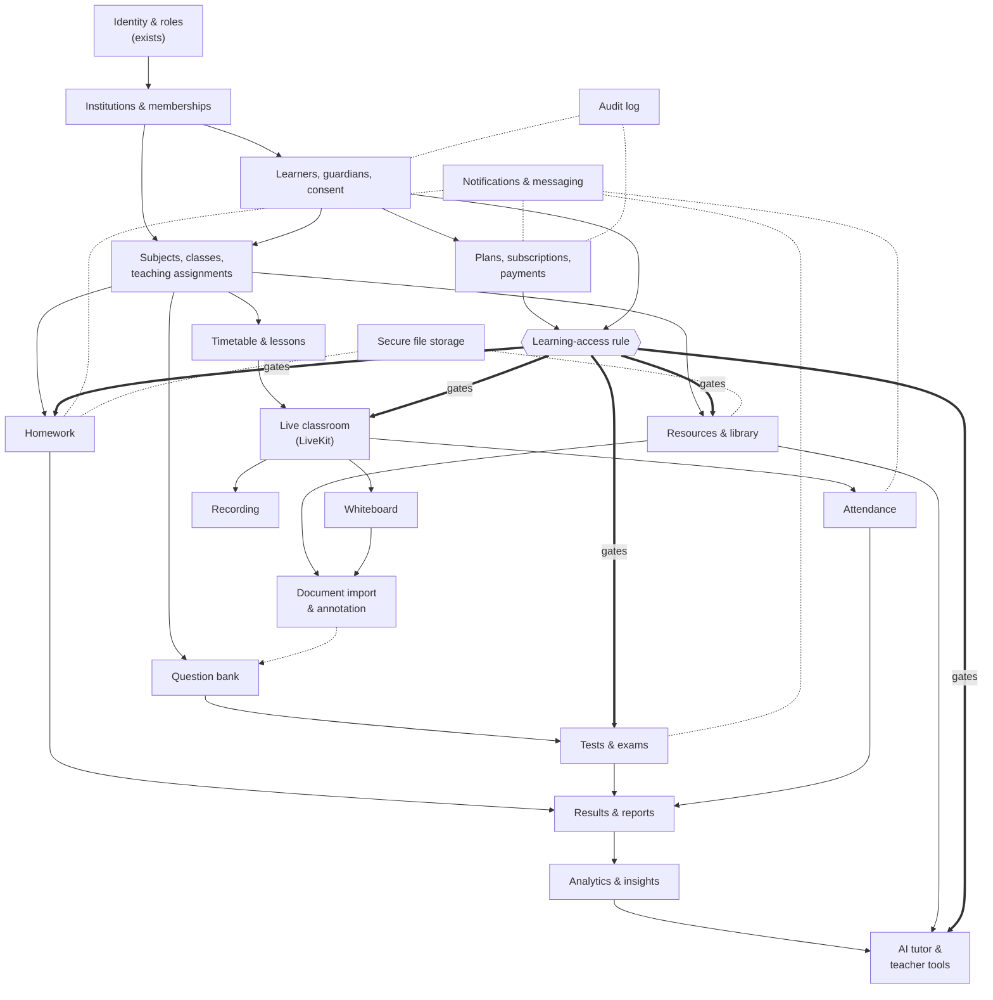

# 5. Module dependency map

An arrow means "must exist before". Dashed lines are cross-cutting services that most modules use.

## Reading the map

| Module                        | Needs first                           | Unlocks                                     |
| ----------------------------- | ------------------------------------- | ------------------------------------------- |
| Institutions & memberships    | Identity                              | Everything school-owned                     |
| Learners, guardians, consent  | Institutions                          | Classes, billing, parent dashboard          |
| Subjects & classes            | Institutions, learners                | Timetable, resources, homework, assessments |
| Subscriptions & payments      | Learners                              | Learning-access rule                        |
| Learning-access rule          | Learners (suspensions), subscriptions | Gating of live lessons, content, work, AI   |
| Timetable & lessons           | Classes                               | Live classroom, attendance                  |
| Live classroom                | Lessons, access rule, LiveKit account | Whiteboard, attendance, recording, hybrid   |
| Whiteboard                    | Live classroom (for sync)             | Document annotation in lessons              |
| Resources & library           | Classes, file storage                 | Document workspace, AI study aids           |
| Document import & annotation  | Resources, whiteboard engine          | Question extraction into the question bank  |
| Homework                      | Classes, file storage                 | Results, parent monitoring                  |
| Question bank → Tests & exams | Classes                               | Results, analytics                          |
| Results & reports             | Homework, assessments, attendance     | Analytics, parent views, certificates       |
| Analytics & insights          | Results                               | AI recommendations                          |
| Notifications                 | Any module that has events            | Parent alerts, reminders                    |

## What this means for scheduling

- **Phase 1 is the trunk.** Every later module needs institutions, learners, classes and the access rule, so nothing else starts before Phase 1 is stable.
- **Phases 2 and 3 can overlap** once Phase 1 is done. The live classroom and the resources library share only the class model.
- **The whiteboard comes before document annotation.** Annotating a paper uses the same engine as the board, so we build it once.
- **The highest-risk item is the hybrid room's audio, because it depends on physical hardware.** I recommend a _throw-away_ prototype in a real classroom early, for example alongside the second half of Phase 1. A problem found there would be cheap to fix early and expensive in Phase 7.
