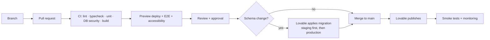

# 9. Deployment strategy

## Environments

| Environment           | Purpose                                                                     | Database                                                                 | Data             |
| --------------------- | --------------------------------------------------------------------------- | ------------------------------------------------------------------------ | ---------------- |
| **Local**             | Development                                                                 | Local Supabase (for database tests)                                      | Seeded fake data |
| **CI**                | Automatic checks on every change                                            | Disposable local Supabase                                                | Seeded fake data |
| **Preview / staging** | Reviewing a change in a real deployment; end-to-end tests; pilot rehearsals | A separate Lovable Cloud test environment or project, _never production_ | Seeded fake data |
| **Production**        | Real schools and families                                                   | Lovable Cloud production                                                 | Real data        |

No real learner data is ever copied into local, CI or staging environments (POPIA).

## How a change reaches production

- **The GitHub repository connected to Lovable is the single source of truth.** Following the Lovable rule in `AGENTS.md`, we never force-push or rewrite published history.
- **Migrations only add things.** New columns are nullable or have defaults, and old columns are removed one release later. That way the running app keeps working while a migration is applied, and a rollback doesn't need the database to go back.
- **Feature switches per institution** let a new module go live for a pilot school before everyone else.
- **Rolling back:** republish the previous version in Lovable. Because migrations only add things, the older version still works against the newer database.

## Secrets and configuration

- All keys (LiveKit, PayFast, email, SMS, OCR, R2) live in **Lovable Secrets** and are read only by server code.
- PayFast and LiveKit webhooks are checked with their signatures; PayFast also by source address and a confirmation call back to PayFast.
- Separate keys for staging and production. Sandbox payment credentials are used outside production.
- Keys are rotated at least yearly and immediately if exposed. The cron secret already supports a current/previous pair for this.

## Monitoring and alerts

| What               | Tool                                                              | Alert when                                                               |
| ------------------ | ----------------------------------------------------------------- | ------------------------------------------------------------------------ |
| Application errors | Sentry (browser + server)                                         | New error type, or error rate spike                                      |
| Uptime             | External uptime checker on `/`, sign-in and the webhook endpoints | Down for 2 minutes or more                                               |
| Database           | Supabase/Lovable dashboards                                       | CPU, connections or storage over 80%                                     |
| Live lessons       | LiveKit Cloud analytics                                           | Connection failure rate or packet loss up during school hours            |
| Payments           | Daily reconciliation job against PayFast                          | Any payment that disagrees, or a notice that failed to process           |
| Scheduled jobs     | Job run log + alert on failure                                    | Expiry or reminder job didn't run                                        |
| Security           | Audit log alerts                                                  | Platform-admin role granted, mass data export, repeated failed admin MFA |

## Backups and recovery

- **Daily automatic backups**, plus point-in-time restore for production. The exact options must be confirmed with Lovable Cloud; if they fall short, this is a reason to move to a directly managed Supabase project.
- **Storage files** (documents, submissions) are copied nightly to separate storage; recordings follow their retention policy.
- **Quarterly restore drill:** restore the latest backup into staging and check it. Phase 7 cannot complete without a successful drill.
- **Targets:** at most 24 hours of lost data with daily backups, or about 5 minutes with point-in-time restore; service restored within 4 hours.

## Launch plan

1. **Pilot:** one school plus a small group of independent families, with feature switches on for them only.
2. **Hybrid rooms** are set up and sound-tested per classroom using a checklist and a standard hardware kit.
3. **Support** runs during school hours during the pilot, with a support-request page in the app.
4. **Wider rollout** happens school by school after the pilot's acceptance sign-off.
