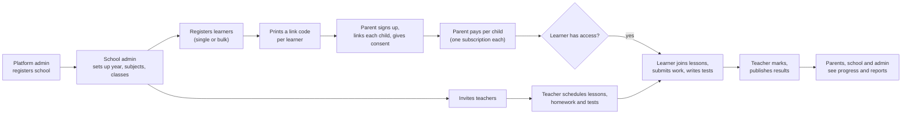

# 11. User journeys

This document shows how each of the five kinds of user moves through the platform, from first registration to teaching, homework, exams, payment and reporting. It also covers how a lesson works when it is taught online, in a physical classroom, or both at once (hybrid).

It sits between two other plan documents. [Pages and navigation](04-pages-navigation.md) lists the screens. [Roles and permissions](03-permissions.md) says who may do what. Here we join them up into the order people actually use them. The **Tracker** column gives the development tracker task that builds each step, so it is clear what has to exist first.

Status shown below: **Exists** = built today · everything else is planned.

---

## The journey on one page

---

## 1. Platform owner (platform admin)

The person who runs LearnBridge as a business. They see across all schools, but every time they open a learner's record it is written to the audit log.

| #   | Stage               | What they do                                                                                        | Screen                            | Rules that apply                                                                | Tracker        |
| --- | ------------------- | --------------------------------------------------------------------------------------------------- | --------------------------------- | ------------------------------------------------------------------------------- | -------------- |
| 1   | Sign in             | Signs in with email and password, then the authenticator-app code                                   | `/auth`, `/account/security`      | MFA is required; admin powers are refused without it                            | P2-01, P2-06   |
| 2   | Register a school   | Reviews an application from `/register/school`, or registers a school directly; approves or rejects | `/admin/institutions`             | Each school becomes a sealed space; its data is never visible to another school | P3-01          |
| 3   | Invite school admin | Invites the school's first administrator by email                                                   | `/admin/institutions/$id`         | Invitation is single-use and expires                                            | P3-01, P3-03   |
| 4   | Set up plans        | Creates monthly, term, annual and custom plans with what each includes                              | `/admin/plans`                    | A plan gives access to one learner only                                         | P9-01          |
| 5   | Watch the platform  | Checks learners, schools, subscriptions, revenue and live lessons running now                       | `/admin`, `/admin/classrooms`     | Uses real data only                                                             | P4-01          |
| 6   | Verify payments     | Checks proof-of-EFT uploads and approves or rejects them; investigates unmatched gateway payments   | `/admin/payments`                 | Approving a payment activates only the learner that payment belongs to          | P9-04          |
| 7   | Handle problems     | Suspends or reactivates a school or user; answers support requests; refunds                         | `/admin/people`, `/admin/support` | Every privileged action records who, what, when and why                         | P2-05          |
| 8   | Report              | Downloads financial and academic reports (PDF, Excel); reviews the audit log                        | `/admin/reports`, `/admin/audit`  | Reports only include what the admin may see                                     | P10-05, P10-06 |

## 2. School administrator

Runs one school (or tutoring centre). Everything they see is limited to their own school.

| #   | Stage                    | What they do                                                                                       | Screen                                            | Rules that apply                                                   | Tracker        |
| --- | ------------------------ | -------------------------------------------------------------------------------------------------- | ------------------------------------------------- | ------------------------------------------------------------------ | -------------- |
| 1   | Accept invitation        | Opens the email link, creates their account, sets up MFA                                           | `/invite/$token`, `/account/security`             | Expired or used links are refused; MFA required                    | P3-03, P2-06   |
| 2   | Set up the school        | Enters school profile, academic year, terms and grades; sets policies (recording, AI, messaging)   | `/school/settings`                                | Year and term drive class lists and report filters                 | P3-02          |
| 3   | Add subjects and classes | Picks subjects from the CAPS list or adds custom ones; creates classes (e.g. Grade 8A)             | `/school/subjects`, `/school/classes`             | —                                                                  | P3-08, P3-09   |
| 4   | Invite teachers          | Invites teachers and assigns them to classes and subjects                                          | `/school/staff`                                   | A teacher sees only the classes they are assigned to               | P3-03, P3-10   |
| 5   | Register learners        | Adds learners one at a time or imports a spreadsheet; the learner number is created automatically  | `/school/learners/new`, `/school/learners/import` | Bad rows are rejected with a clear report; duplicates are caught   | P3-05, P3-07   |
| 6   | Connect families         | Prints or sends each learner's single-use parent link code                                         | `/school/learners/$id`                            | Nobody can link to a child without the code or school verification | P3-06          |
| 7   | Build the timetable      | Creates the weekly timetable; the system warns about teacher or room clashes                       | `/school/timetable`                               | Times are stored safely across time zones                          | P4-06          |
| 8   | Run the term             | Watches attendance, homework and test status; moves or promotes learners; suspends at school level | `/school`, `/school/attendance`                   | Moving a learner keeps their history                               | P4-02, P3-08   |
| 9   | Exams                    | Schedules exam windows, moderates marks and approves results for publishing                        | `/school/assessments`                             | Learners and parents only see results once published               | P8-03, P8-07   |
| 10  | Billing                  | If the school collects fees: views learner subscriptions and verifies manual payments              | `/school/billing`                                 | One learner's payment never activates another                      | P9-02, P9-04   |
| 11  | Report                   | Exports academic, attendance and billing reports                                                   | `/school/reports`                                 | Scoped to this school only                                         | P10-05, P10-06 |

## 3. Teacher

Teaches one or more classes, possibly at more than one school (they switch school in the top bar).

| #   | Stage              | What they do                                                                                           | Screen                                       | Rules that apply                                                            | Tracker              |
| --- | ------------------ | ------------------------------------------------------------------------------------------------------ | -------------------------------------------- | --------------------------------------------------------------------------- | -------------------- |
| 1   | Join               | Accepts the school's invitation and creates an account (or signs in to an existing one)                | `/invite/$token`                             | Lands in `/teach` with only assigned classes                                | P3-03                |
| 2   | See today          | Opens the dashboard: next lessons with **Start lesson**, marking queue, learners who need attention    | `/teach` _(sample version exists)_           | Shows only assigned classes                                                 | P4-03                |
| 3   | Prepare materials  | Uploads notes and question papers, organises them by grade, subject and topic, schedules release       | `/teach/resources`, `/teach/documents/$id`   | Learners only see published materials for their subjects                    | P5-01 – P5-05        |
| 4   | Prepare a paper    | Opens an uploaded paper as pages, writes on it; optionally checks extracted questions side by side     | `/teach/documents/$id`                       | The original paper is never changed                                         | P5-05 – P5-07        |
| 5   | Schedule a lesson  | Schedules a live lesson for a class and subject (online, physical or hybrid)                           | `/teach/timetable`                           | Only enrolled learners with access can join                                 | P6-02                |
| 6   | Teach live         | Starts the lesson, admits learners, teaches on the whiteboard, shares a screen, manages hands and chat | `/teach/lessons/$id/live`                    | See [section 6](#6-one-lesson-online-physical-and-hybrid)                   | P6-03 – P6-12        |
| 7   | Set homework       | Creates homework with instructions, files, marks and a due date for selected classes or learners       | `/teach/homework`                            | Appears for learners at the release time                                    | P7-01                |
| 8   | Mark homework      | Marks submissions, adds comments, returns work for correction                                          | `/teach/homework/$id/marking`                | Marking is audited; results released when the teacher chooses               | P7-03                |
| 9   | Set a test or exam | Builds a test from the question bank, sets time, marks and open/close window                           | `/teach/assessments`, `/teach/question-bank` | Checked and versioned before it is published                                | P8-01 – P8-03        |
| 10  | Mark and publish   | Reviews automatic marks, marks written answers, sends for moderation, publishes                        | `/teach/assessments/$id/marking`             | Parents and learners see results only after publishing                      | P8-06 – P8-08        |
| 11  | Track progress     | Views attendance (physical vs online), homework status and results per learner and class               | `/teach/classes/$id`, `/teach/progress`      | No data from other teachers' classes                                        | P6-09, P7-04, P10-05 |
| 12  | Talk to parents    | Sends class announcements; messages parents of learners they teach; books meetings                     | `/messages`, `/family/meetings`              | Communication rules in [Permissions](03-permissions.md#communication-rules) | P7-05, P7-06         |

## 4. Student (learner)

A learner can exist before they have a login. Young learners often never sign in themselves; a parent or the classroom does it with them.

| #   | Stage           | What they do                                                                             | Screen                              | Rules that apply                                                                | Tracker       |
| --- | --------------- | ---------------------------------------------------------------------------------------- | ----------------------------------- | ------------------------------------------------------------------------------- | ------------- |
| 1   | Get registered  | The school registers them, or a parent registers them as an independent learner          | (done by school or parent)          | Each learner is their own account, even if siblings share a parent              | P3-05         |
| 2   | Get a login     | The school or parent issues a learner login: learner number + password (email optional)  | `/auth/learner`                     | Learner sees only their own information                                         | P2-01         |
| 3   | Check access    | On sign-in the system checks subscription and suspensions                                | `/learn` or `/suspended`            | Suspended or expired: a notice explains who and why; records are kept           | P9-02, P9-07  |
| 4   | See today       | Dashboard shows the next lesson (**Join**), homework due, upcoming tests, notices        | `/learn`                            | Only enrolled subjects and classes                                              | P4-04         |
| 5   | Study           | Opens notes and resources for each subject; may download some for offline use            | `/learn/subjects/$id`               | Exam material is never cached offline                                           | P5-04, P10-07 |
| 6   | Attend a lesson | Joins online, or checks in as physically present in the classroom                        | `/learn/lessons/$id/live`           | See [section 6](#6-one-lesson-online-physical-and-hybrid)                       | P6-03, P6-11  |
| 7   | Do homework     | Writes an answer, uploads a file or photo; drafts are saved; submits before the due date | `/learn/homework/$id`               | Late submissions are marked late; files are private                             | P7-02         |
| 8   | Write a test    | Opens the test in its window; timer, question navigator; answers save automatically      | `/learn/assessments/$id/attempt`    | A refresh or dropped connection loses no answers; a warning before final submit | P8-04, P8-05  |
| 9   | See results     | Views marks and feedback once released; sees progress over time                          | `/learn/results`, `/learn/progress` | Own results only                                                                | P8-08         |
| 10  | Get help        | Uses the AI tutor where school, parent and plan allow it                                 | `/learn/tutor`                      | Teachers can switch AI off for homework and tests; answers are labelled as AI   | P10-02        |

## 5. Parent or guardian

One parent account can be linked to several children. Each child keeps their own account, subscription and records.

| #   | Stage                 | What they do                                                                                          | Screen                                    | Rules that apply                                                                            | Tracker      |
| --- | --------------------- | ----------------------------------------------------------------------------------------------------- | ----------------------------------------- | ------------------------------------------------------------------------------------------- | ------------ |
| 1   | Sign up               | Creates an account with email and password                                                            | `/register/parent`                        | —                                                                                           | P2-01, P3-04 |
| 2   | Link children         | Enters the school's link code for each child, or registers an independent learner                     | `/family/add-child`                       | Code is single-use and expires; nobody can claim a child by name                            | P3-06        |
| 3   | Give consent          | Agrees per child to data processing, and separately to recording, AI help and messaging               | `/family/add-child`, `/family/$learnerId` | Consent is recorded with who, when and which policy version (POPIA)                         | P3-04        |
| 4   | Choose a plan and pay | Picks a plan for one child and pays by card or Instant EFT, or uploads proof of a bank EFT            | `/family/$learnerId/subscription`         | **Paying for one child never activates another**                                            | P9-02, P9-03 |
| 5   | Wait for activation   | Gateway payments activate at once; manual EFT activates after the school or admin verifies it         | `/family`                                 | Child stays pending until their own payment is confirmed                                    | P9-04        |
| 6   | Follow each child     | Switches between children to see attendance, homework, timetable, tests and results                   | `/family`, `/family/$learnerId/...`       | Sees only children they are verified to be linked to                                        | P4-05        |
| 7   | Get updates           | Receives a weekly summary and alerts (missed homework, low marks, payment due) in-app or by email/SMS | `/notifications`                          | Respects their notification preferences                                                     | P4-07, P9-09 |
| 8   | Talk to the school    | Messages their child's teachers; books a parent-teacher meeting (online or in person)                 | `/messages`, `/family/meetings`           | Only with teachers of their own children                                                    | P7-05, P7-06 |
| 9   | Renew                 | Gets reminders before expiry; renews per child                                                        | `/family/$learnerId/subscription`         | Expiry pauses lessons and new content but never deletes records                             | P9-05        |
| 10  | Suspend or reactivate | Temporarily suspends one child's access (e.g. a break), then reactivates the same account later       | `/family/$learnerId/access`               | Affects only that child; audited; records kept; a parent can only lift their own suspension | P9-07, P9-08 |
| 11  | Payments and receipts | Views all payments and receipts, listed per child                                                     | `/family/payments`                        | Each child's history is separate                                                            | P9-06        |

---

## 6. One lesson: online, physical and hybrid

The same lesson can be taught three ways. The teacher picks the mode when scheduling and can change it on the day.

| Step             | Online only                                                                                  | Physical only                                                                                 | Hybrid (both at once)                                                                                                             |
| ---------------- | -------------------------------------------------------------------------------------------- | --------------------------------------------------------------------------------------------- | --------------------------------------------------------------------------------------------------------------------------------- |
| **Before**       | Learners see **Join** on `/learn` shortly before the start                                   | Lesson shows on the timetable; no join needed                                                 | The classroom PC is set up in _room mode_ with a conference speakerphone; teacher runs the device test                            |
| **Joining**      | Learner joins; waiting room until the teacher admits them                                    | Teacher ticks attendance on the class list, or learners enter the code shown on the projector | Remote learners join online; in-room learners check in as present (optional own device joins with mic and speaker forced **off**) |
| **Access check** | Subscription and suspension checked before the token is issued                               | Same check when attendance is recorded                                                        | Same check for both groups                                                                                                        |
| **Teaching**     | Whiteboard, screen share, video; hands and chat                                              | Teacher uses the board on the projector (`/teach/lessons/$id/room`)                           | One room microphone carries the teacher and in-room questions to remote learners; remote learners are played into the room        |
| **Taking part**  | Raise hand, chat, answer polls                                                               | In person                                                                                     | Both groups can raise a hand; the teacher sees one queue                                                                          |
| **Attendance**   | From join/leave events on the server; reconnects don't double-count                          | From the class list or check-in code                                                          | Recorded per learner with the mode (physical or online)                                                                           |
| **Recording**    | Only if school policy and each learner's consent allow it; everyone sees a recording notice  | Same                                                                                          | Same; learners without recording consent are left out of the recording                                                            |
| **After**        | Recording (if any) appears in `/learn/recordings`; attendance reaches parents and the school | Same                                                                                          | Same                                                                                                                              |

If the teacher's connection drops, the room stays open for a short grace period so a co-teacher or the classroom PC can take over.

---

## 7. What happens when things go wrong

| Situation                            | What the user sees                                                                   | What the system does                                                           |
| ------------------------------------ | ------------------------------------------------------------------------------------ | ------------------------------------------------------------------------------ |
| Signed in, but no school or role yet | `/access-pending`: "Your account is waiting for a school to give you access"         | Nothing else is shown until a role is assigned                                 |
| Subscription expired                 | Learner: notice with the renewal date. Parent: **Renew** button on that child's card | Live lessons, new content, tests and AI pause; records stay viewable           |
| Suspended by parent or school        | `/suspended` explains who suspended the account and why                              | Each suspension source can only be lifted by whoever set it; records kept      |
| Suspension starts during a test      | The learner can finish the test already in progress                                  | Exception in the access rule (already built in `src/domain/learner-access.ts`) |
| Manual EFT not yet verified          | Child's card shows "Payment received — being checked"                                | Stays pending; admin verification queue                                        |
| Link code wrong, used or expired     | "This code can't be used. Ask the school for a new one."                             | No link is created; attempt is logged                                          |
| Connection drops during a test       | "Reconnecting… your answers are saved"                                               | Server keeps the authoritative save time; no answers lost                      |
| Connection drops during a lesson     | Automatic reconnect; data-saver mode offered on slow networks                        | Attendance continues from the same record                                      |

---

## What this means for building

- **Each journey depends on the one before.** Parents can't link children until schools register learners, and learners can't join lessons until both a class and a subscription exist. This is why the tracker builds schools and people (P3) before dashboards (P4) and lessons (P6).
- **The access check is the same everywhere.** Joining a lesson, opening a resource, starting a test and using the AI tutor all ask one question: does this learner have access right now? That rule is already written and tested in `src/domain/learner-access.ts`, and the database version mirrors it.
- **Every journey must be testable end to end.** Each row above that names a screen will get a browser test when its tracker task is built (P1-06 sets up the tool for this).
